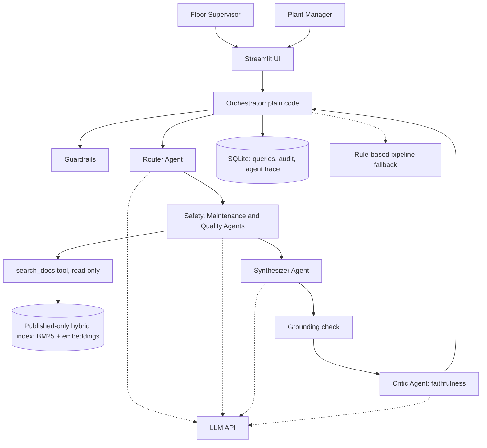
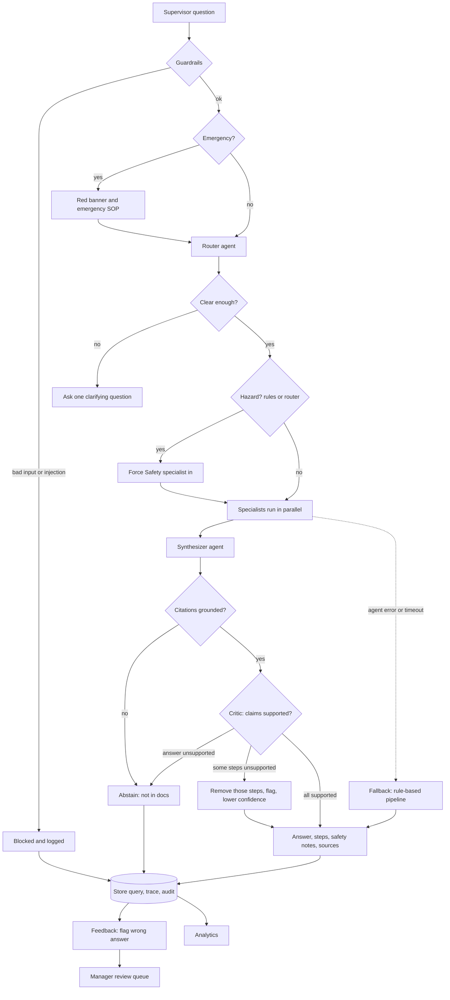
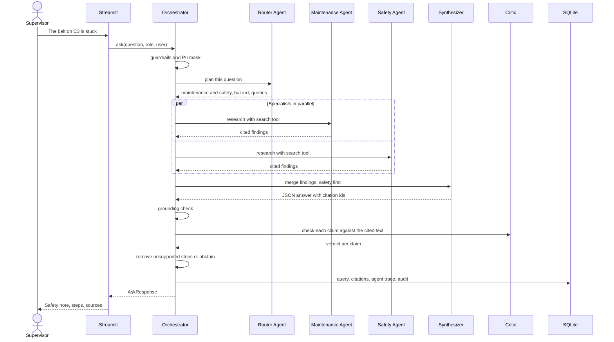

# FAST: Architecture (v2: AI-powered, supervised multi-agent)

FAST routes floor supervisors' questions to the right approved documentation using a small team of LLM agents, and returns grounded, cited answers. All data is **synthetic**.

> **Build status.** The deterministic control plane, the rule-based pipeline (used as fallback), guardrails, audit, analytics and the UI contract are **built and tested**. The LLM agents (router, specialists, synthesizer, faithfulness critic) and hybrid search are **built and evaluated live: 63/67 on the 67-case golden set**.

## 1. Solution architecture



| Component | Type | Responsibility | Business "why" |
|---|---|---|---|
| Orchestrator | Code | Runs the stages in a fixed order, dispatches specialists in parallel, enforces caps and timeouts, falls back on failure | Predictable behaviour; no runaway agent on the floor |
| Guardrails | Code | Length and type checks, injection and safety-bypass blocking, emergency detection, PII masking | Protects people; keeps logs clean |
| **Router agent** | LLM | Understands the question, picks the sources, extracts equipment, flags hazards, rewrites per-source search queries, asks for clarification | Handles messy wording that keywords miss |
| **Specialist agents ×3** | LLM + tools | Each searches only its own manuals (max 3 steps) and returns cited findings or abstains | Domain focus; faster in parallel; fewer cross-source mistakes |
| **Synthesizer agent** | LLM | Merges findings, safety first, notes conflicts and gaps, outputs strict JSON | One clear answer instead of three documents |
| Hazard override | Code | Keyword rules ∪ router flag → Safety specialist always runs | A model slip can never drop the safety step |
| Retriever | Code | Hybrid search over section chunks: BM25 + local embeddings (`bge-small`), merged with RRF; **published documents only**, capped per category | Supervisors only see approved procedures |
| Grounding check | Code | Every citation must be a retrieved section, else drop it or abstain | Blocks invented sources |
| Rule-based pipeline | Code | v1 router and extractive answer, used when agents fail or `agents.mode: pipeline` | The demo and the floor keep working if the LLM API fails |
| Docs admin, Audit, Analytics | Code | Draft → approve → publish; audit trail; KPIs and recurring issues | Compliance and visibility for managers |
| **Critic agent** | LLM | Checks each answer claim against the retrieved text; removes unsupported steps, abstains on an unsupported answer, never removes safety notes | Catches a confident wrong answer that cites a real section |
| *Stretch:* Insights agent | LLM | Manager summaries and gap clustering | Next insight step |

## 2. Data flow



## 3. Request sequence (one question, end to end)



## 4. File structure (status in brackets)

```
FAST/
├── app/
│   ├── main.py, views/, ui/          Streamlit frontend [built]: Ask, Documents (approve / advise / reject),
│   │                                 Review queue, Analytics, Diagnostics, Traces & logs (admin), Users & access (admin)
│   ├── agents/                       [built]
│   │   ├── base.py                   agent runner: tool loop, caps, trace
│   │   ├── prompts.py                prompts and PROMPT_VERSION
│   │   ├── router_agent.py           RouterPlan
│   │   ├── specialists.py            safety / maintenance / quality
│   │   ├── synthesizer.py            merge, structured answer
│   │   └── orchestrator.py           stages, parallelism, fallback
│   ├── services/                     [built]
│   │   ├── workflow.py               ask(): picks agents.mode
│   │   ├── llm.py                    mock / openai / anthropic adapter
│   │   ├── router.py, retriever.py, guardrails.py   (rule-based fallback, retrieval, guards)
│   │   ├── docs_admin.py, audit.py, analytics.py
│   ├── observability.py          trace list/detail, timeline, metrics + drill-down, log search
│   ├── users.py                  access requests, approval, sign-in, lockout
│   ├── pricing.py                token price table (cost estimates)
│   ├── models/schemas.py             [built] Pydantic contract incl. AgentStep
│   ├── data/db.py, seed_synthetic.py, corpus/*.md (18 synthetic docs + 1 draft)
│   └── observability/logging.py
├── evals/ golden.jsonl, run.py, results/
├── tests/                            pytest
├── docs/                             design, architecture, data model, scope, risks, slide
├── scripts/                          render_mermaid.py, make_docx.py, make_pptx.py
└── config.yaml, .env.example, requirements.txt, README.md
```

## 5. Configuration

```yaml
llm:
  provider: openai            # openai | anthropic | mock   (key in .env only)
agents:
  mode: multi_agent           # multi_agent | pipeline (rule-based fallback)
  timeout_s: 25
  token_budget: 16000
  router:       { model: gpt-4o-mini, max_tokens: 300 }
  specialist:   { model: gpt-4o-mini, max_tokens: 700, max_steps: 3 }
  synthesizer:  { model: gpt-4o-mini, max_tokens: 900 }
  critic:       { enabled: true, model: gpt-4o-mini, max_tokens: 700, max_unsupported_ratio: 0.34 }
retrieval:
  mode: hybrid                # hybrid | bm25   (env FAST_RETRIEVAL_MODE)
  embedder: local             # local bge-small | openai | hash   (env FAST_EMBEDDER)
  reranker: none              # cross-encoder built, off by default   (env FAST_RERANKER)
```

## 6. Observability and access control

- **Trace write path.** `workflow.ask()` collects the `AgentStep` list (including the pre-fetched search and, on failure, the partial steps plus a `fallback_to_pipeline` guard). `_finish()` writes the query row, its citations, every step (`agent_steps`, with masked input/output and cost) and the audit row in **one transaction**.
- **Trace read path.** `services/observability.py` builds the trace list, trace detail, waterfall, aggregates and drill-down from those tables. The *Traces & logs* page is a thin view over it. Only administrators can open it.
- **Access.** `ui/common.init()` is the gate on every page: no signed-in account means the sign-in / request-access form and nothing else. The account is re-read from the database on each page run, so disabling a user or changing a role takes effect on their next click. Admin-only pages check the role again (`require_admin`).
- **Account lifecycle.** request (pending) → administrator approves with a role or denies → sign-in. Lockout after repeated failures. All steps are written to `audit_log`.

